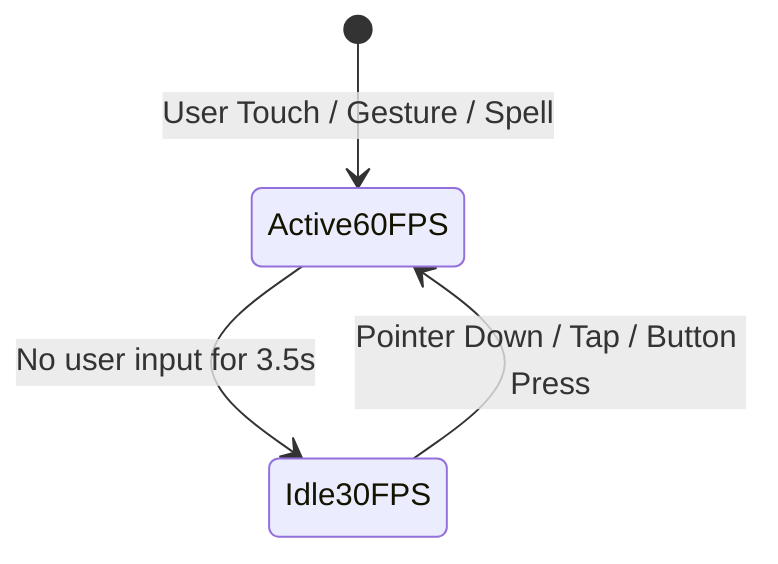
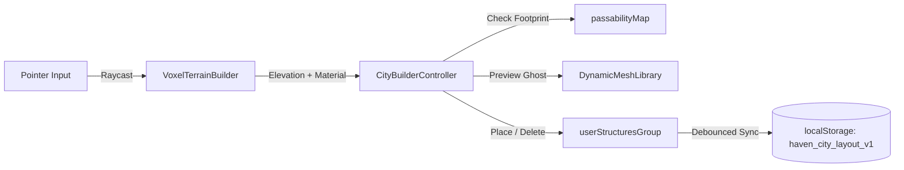

# System Architecture & Technical Specifications

This document outlines the architectural boundaries, mathematical foundations, and rendering pipelines of **Haven of Companions**.

---

## 1. Spatial Coordinate System

The 3D diorama operates in a right-handed Cartesian coordinate space where:
- **$+X$**: East (toward Sunspire Town Plaza and coastal tea pavilion)
- **$+Y$**: Vertical Elevation (height above sea level)
- **$+Z$**: South (toward coastal harbor, boardwalk piers, and open ocean)

```
                       Highlands Plateau (Tier 3)
                              [Y = 1.8]
                             /        \
                            /          \
                Stone Steps             Town Square (Tier 2)
                                              [Y = 0.9]
                                                  \
                                            Ramps  \
                                                    Coastal Harbor (Tier 1)
                                                           [Y = 0.25]
                                                                \
                                                                 Ocean Bay [Y = -0.06]
```

### Elevation Tiers
1. **Tier 3 (Highlands Clifftop)**: $Y = 1.8$, Bounds: $X \in [-7, 0]$, $Z \in [-7, 0]$.
2. **Tier 2 (Sunspire Town Square)**: $Y = 0.9$, Bounds: $X \in [0, 7.5]$, $Z \in [-7, 1]$.
3. **Tier 1 (Coastal Harbor & Shore)**: $Y = 0.0$ to $0.25$, Bounds: $X \in [-7, 7.5]$, $Z \in [1, 5]$.
4. **Ocean Water Plane**: $Y = -0.06$, Bounds: $X \in [-9.5, 9.5]$, $Z \in [2.5, 8.5]$.

---

## 2. Camera Projection & Tactical Rotation Math

### 2.1 Perspective Isometric View
Rather than an orthographic projection (which lacks depth perception for vertical cliffs), the game uses a low-FOV perspective camera ($32^\circ$) positioned far away:
$$\text{FOV} = 32^\circ, \quad \text{Distance} \in [9.0, 32.0]$$
This achieves the classic tactical isometric angle (reminiscent of *Divinity: Original Sin 2* or *Final Fantasy Tactics*) while preserving natural parallax.

### 2.2 Spherical Coordinate Rotation
The camera's position $\mathbf{P}_{\text{cam}}$ is computed dynamically from its look-at target $\mathbf{T}$ using spherical angles:
$$\mathbf{P}_{\text{cam}} = \mathbf{T} + \mathbf{D} \cdot \begin{pmatrix} \sin(\theta) \cos(\phi) \\ \sin(\phi) \\ \cos(\theta) \cos(\phi) \end{pmatrix}$$
Where:
- $\theta$ (`azimuthAngle`): Angle of rotation around the vertical $Y$ axis (default: $\pi / 4 = 45^\circ$).
- $\phi$ (`elevationAngle`): Elevation above the ground plane (default: $\approx 0.61 \text{ rad} \approx 35^\circ$).
- $\mathbf{D}$ (`distance`): Distance from target (default: $18\text{m}$).

### 2.3 Screen-Space to Ground Movement Projection
When panning with a single finger, 2D screen deltas $(\Delta x, \Delta y)$ are projected onto the rotated camera's local horizontal axes so panning always aligns with the player's swipe direction regardless of camera angle:
$$\mathbf{v}_{\text{right}} = \begin{pmatrix} \cos(\theta) \\ 0 \\ -\sin(\theta) \end{pmatrix}, \quad \mathbf{v}_{\text{fwd}} = \begin{pmatrix} -\sin(\theta) \\ 0 \\ -\cos(\theta) \end{pmatrix}$$
$$\Delta \mathbf{T}_{\text{ground}} = \left( -\Delta x \cdot \mathbf{v}_{\text{right}} + \Delta y \cdot \mathbf{v}_{\text{fwd}} \right) \cdot \text{scale}$$

---

## 3. 3D-to-2D UI Projection

To overlay in-world typewriter speech bubbles and character nameplates cleanly over 3D avatars, the engine projects the 3D character head world position $\mathbf{P}_{\text{world}}$ into 2D viewport pixels:

$$\mathbf{P}_{\text{NDC}} = \mathbf{P}_{\text{world}} \times \mathbf{M}_{\text{view}} \times \mathbf{M}_{\text{proj}}$$
$$x_{\text{screen}} = \left( \frac{\mathbf{P}_{\text{NDC}}.x + 1}{2} \right) \cdot W_{\text{window}}$$
$$y_{\text{screen}} = \left( \frac{-\mathbf{P}_{\text{NDC}}.y + 1}{2} \right) \cdot H_{\text{window}}$$

This guarantees that speech bubbles stick to the character's head with zero drifting during panning, zooming, and $360^\circ$ camera rotations.

---

## 4. Dynamic Lighting & Shadows

- **Directional Sun Light**: Sized shadow frustum covering $[-10, 10]$ across $X$ and $Z$ with a $1024 \times 1024$ shadow map. Shadow bias is tuned to $-0.0006$ to eliminate shadow acne on cliff faces.
- **Campfire Point Light**: Equipped with real-time Perlin-style sinusoidal flame flicker:
  $$I_{\text{fire}} = I_{\text{base}} + \sin(t \times 0.008) \cdot 0.25 + \sin(t \times 0.023) \cdot 0.15$$
- **Lighthouse Beacon Light**: Continuous circular beam sweep across the water:
  $$\mathbf{P}_{\text{beacon}} = \begin{pmatrix} 7.2 + \cos(t \times 0.0025) \cdot 0.8 \\ 5.3 \\ 4.8 + \sin(t \times 0.0025) \cdot 0.8 \end{pmatrix}$$

---

## 5. Adaptive Performance Scheduler



- **Active State (60 FPS)**: Render loop ticks every $16\text{ms}$ when panning, zooming, rotating, or animating active 3D particle spells.
- **Idle State (30 FPS)**: Render loop throttles to $33\text{ms}$ when no touch events occur, reducing mobile GPU utilization by up to $65\%$.

---

## 6. City Builder & Sandbox Construction Subsystem

Adapted from Kenney's Starter Kit City Builder, the sandbox construction engine allows free-form placement, rotation, and demolition of structures across the $70 \times 70$ voxel map:



### Key Mathematical & Architectural Invariants:
1. **Grid Snapping**: Continuous floating-point coordinates $(x, z)$ are quantized into integer grid coordinates $(g_x, g_z) = (\text{round}(x), \text{round}(z))$.
2. **Elevation Invariance**: Height is sampled directly from voxel heightmaps: $y = \text{VoxelTerrainBuilder.getTopElevation}(g_x, g_z) + y_{\text{offset}}$.
3. **Multi-Cell Collision Verification**:
   For any structure with footprint $W \times D$:
   $$\Delta y_{\text{max}} = \max_{(dx, dz)} |y(g_x + dx, g_z + dz) - y(g_x, g_z)| \le 1.2\text{m}$$
   Any footprint overlapping deep water ($y \le 0$) or existing structures is rejected with red ghost feedback.
4. **Dynamic Walkability Reservation**:
   When placed, the bounding footprint is reserved in `passabilityGrid.markCustomObstacle(minX, maxX, minZ, maxZ, true)`, immediately updating companion A* navigation meshes.
5. **Serialization Schema**:
   Structures are persisted to `localStorage` under `haven_city_layout_v1` as versioned JSON records containing `{ instanceId, structureId, gridX, gridZ, elevationY, rotationY }`.

---

## 7. 3D Platformer & Dynamic Mechanics Subsystem

### 7.1 Collectibles Loop (`CollectibleMeshBuilder.ts`)
- **Proximity Field**: Computed every frame via Euclidean 2D distance:
  $$d_{\text{pickup}} = \sqrt{(x_{\text{hero}} - x_{\text{item}})^2 + (z_{\text{hero}} - z_{\text{item}})^2} \le 1.35\text{m}$$
- **State Machine**: Active items bob with vertical sine wave $y(t) = y_0 + \sin(t \times 2.8) \times 0.08$ and rotate around the Y axis. On pickup, the item is hidden, plays a procedural Web Audio chime, increments `coinScore`, and schedules a respawn at $t + 25\text{s}$.

### 7.2 Dynamic Interactive Platforms (`DynamicPlatformManager.ts`)
- **Falling Pier Plank**: Sinks into the water $0.85\text{s}$ after character contact, temporarily removing walkability, and returns to surface level after $4.0\text{s}$.
- **High-Jump Thermal Vent**: Stepping within $1.1\text{m}$ applies upward vertical launch velocity $v_y = 10.8\text{m/s}$, giving the hero sufficient vertical clearance ($>5\text{m}$) to reach high clifftops.

---

## 8. Dual Ability 3D VFX & Procedural Equipment Pipeline

### 8.1 GPU-Batched VFX Engine (`src/engine/three/SpellEffect3D.ts`)
- **Single Draw Call Optimization**: All 18 active and ultimate abilities utilize `three.quarks` `BatchedRenderer` sharing geometry and particle textures (Kenney Particle Pack in `public/textures/particles/`).
- **Dynamic Point Light Management**: Each ability can allocate a transient Three.js `PointLight` at cast origin. A dedicated decay timer smoothly interpolates intensity down to zero before removing the light from the scene to prevent WebGL light count saturation.
- **Procedural Sound Synthesis**: Every ability effect triggers a corresponding micro-synthesizer oscillator envelope via the Web Audio API in `src/audio/audioManager.ts`, generating melodic harps, whooshes, chimes, or bass drops without loading external `.mp3` audio files.

### 8.2 Procedural Mythic Arsenal Engine (`src/engine/three/equipment/EquipmentGenerator.ts`)
- **Procedural Mesh Router**: Equipment with `proc:` model IDs bypass GLTF file loads and are generated programmatically via Three.js primitives (lathes, extruded profiles, faceted cones, and torus rings).
- **Physical Materials (PBR)**: Utilizes `THREE.MeshPhysicalMaterial` with transmission ($0.85$–$0.95$), roughness, metalness, and emissive bloom intensity.
- **Two-Handed Socket & Grip Matrix (`CharacterMeshBuilder.ts`)**:
  - `WEAPON_GRIP_CONFIGS`: Maps weapon archetypes (`greatsword`, `colossal_hammer`, `scythe`, `polearm`, `bardic_lute`, `dual_chakram`) to precise position, rotation, and scale offsets relative to `handslot.r`.
  - `is2H` Invariant: Automatically suppresses offhand shields or items on `handslot.l` when a two-handed weapon is equipped, preventing mesh clipping during combat stances and walking animations.

---

## 9. Environmental Shaders & Nature Subsystem

### 9.1 Godot Toon Water Material (`src/engine/three/materials/GodotWaterMaterial.ts`)
- **GPU Wave Synthesis**: Dual-layer Simplex wave distortion executed directly in vertex and fragment shaders. Evaluates counter-propagating wave coordinates ($1.5\times$ scale layer offset) with zero CPU memory or vertex allocation loops.
- **Toon Lighting Thresholds**: 12 discrete stepped diffuse bands and 8 stepped specular glints with `smoothstep` edge smoothing.
- **Stylized Faceted Normals**: Hardware screen derivatives (`dFdx(vWorldPos)`, `dFdy(vWorldPos)`) produce faceted low-poly planar water facets.
- **Wave Foam**: Procedural wave crest thresholding (`smoothstep(0.68, 0.88, vWave)`) yielding bright white foam crests against an aquatic cyan-to-deep navy gradient.

### 9.2 Godot Instanced Grass & Dither System (`src/engine/three/nature/GodotGrassManager.ts`)
- **Instanced Rendering**: Renders 1,200 instanced grass quads (`THREE.InstancedMesh`) positioned dynamically on top of terrain blocks using `VoxelTerrainBuilder.getTopElevation()`.
- **Bayer 4x4 Ordered Dithering**: Ported from `dither.gdshaderinc`. Evaluates a $4\times 4$ Bayer matrix against alpha threshold to generate retro pixel-art dithering, completely avoiding WebGL alpha sorting contention and depth fighting.
- **Root-Anchored Wind Sway**: Quadratic height dampening $\text{pow}(\text{uv.y}, 1.8)$ anchors the blade roots firmly to the ground while upper tips sway in real time with global wind vectors.
- **3-Stop Color Palette**: Maps spatial noise across coordinates to Godot's `palette_01.tres` (deep forest green `#468232` $\rightarrow$ meadow green `#75a743` $\rightarrow$ lime `#a8ca58`).

### 9.3 Cel-Shaded Anime Flame & Campfire Hearth (`src/engine/three/effects/CartoonFireMesh.ts`)
- **3D Procedural Flame**: Tapered cylinder deformed by upward-scrolling 2D Simplex noise with 3 stepped anime color bands (white core $>0.80$, gold $>0.62$, orange $>0.42$).
- **24 Rising Ember Sparks**: `THREE.Points` with additive blending, horizontal sinusoidal swirl, and height reset wrapping.

---

## 10. Automated Production Deployment Pipeline


- **Workflow File**: `.github/workflows/deploy.yml`
- **Build Invariant**: `vite.config.ts` must use relative base path (`base: './'`).
- **Cache Invalidation**: Service Worker cache name (`CACHE_NAME` in `public/sw.js`) bumped on each release.
- **Production URL**: `https://minhhoangdono.github.io/haven-of-companions/`
