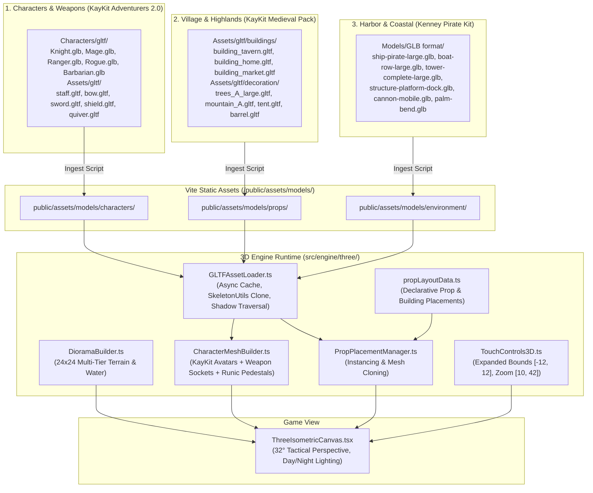

# KayKit Adventurers Remodel, Medieval Village & 24x24 Map Expansion

## 1. Executive Summary

This plan updates the 3D asset architecture for **Haven of Companions** (*Làng Tri Kỷ*) to leverage the best-in-class assets available on disk:
1. **Character Remodel with Class Armor & Weapons**: Replace procedural humanoid primitives with **`KayKit_Adventurers_2.0_FREE`** (`Knight.glb`, `Mage.glb`, `Ranger.glb`, `Rogue.glb`, `Barbarian.glb`, `Rogue_Hooded.glb`). These models feature authentic fantasy class outfits, helmets, robes, and quiver/weapon sockets.
2. **Village & Highland Environment**: Use **`KayKit_Medieval_Hexagon_Pack_1.0_FREE`** for medieval buildings (tavern, cottages, market stalls, church, windmill, castle walls), campsites (tents, weapon racks, lumber), and nature (dense pine tree clusters, mountain crags, hills).
3. **Maritime Harbor, Ships & Lighthouse**: Use **`kenney_pirate-kit`** for maritime coastal assets (pirate galleon, rowboats, stone beacon lighthouse, wooden dock piers, cannons, tropical palms, and reef boulders).
4. **24x24 World Expansion**: Expand the diorama ground footprint from $16 \times 16$ ($X, Z \in [-8, 8]$) to $24 \times 24$ ($X, Z \in [-12, 12]$) — a **$125\%$ increase in explorable area** that creates vast physical contrast between the Highland Mountain Plateau, Sunspire Town Square, Coastal Bay & Harbor, and the rocky Outer Lighthouse Promontory.
5. **Declarative Fast-Placement Workflow**: Establish `propLayoutData.ts` allowing instant copy-pasting of buildings, trees, ships, and clutter without writing Three.js geometry boilerplate.

---

## 2. Integrated Asset Triad Architecture



---

## 3. Topographical Zone Layout (24x24 Grid)

```
                       NORTH (-Z)
             [-12, -12]              [12, -12]
                 +-----------------------+
                 | ZONE 1:               | ZONE 2:
                 | HIGHLAND MOUNTAIN     | SUNSPIRE PLAZA &
                 | PLATEAU (Y = +2.4)    | TOWN SQUARE (Y = +1.0)
                 | KayKit Pine Forests,  | KayKit Medieval Tavern,
                 | Mountains & Campsite  | Cottages, Market Stalls,
                 | Tent & Altar          | Radiant Sun Fountain
WEST (-X)        |                       |                         EAST (+X)
                 |-----------------------|-----------------------|
                 | ZONE 3:               | ZONE 4:
                 | COASTAL BAY &         | LIGHTHOUSE REEF &
                 | HARBOR (Y = -0.3..0.2)| PROMONTORY (Y = +0.8)
                 | Kenney Pirate Galleon,| Kenney Stone Lighthouse,
                 | Rowboats, Docks Pier, | Reef Rocks, Palms,
                 | Sandy Beach Slope     | Wave-breaker Rocks
                 +-----------------------+
             [-12, 12]               [12, 12]
                       SOUTH (+Z)
```

---

## 4. Phase Breakdown

| Phase | Title | Effort | Primary Files Modified / Created | Objective |
| :--- | :--- | :--- | :--- | :--- |
| **Phase 1** | **Asset Audit & Triad Mapping** | 2h | `scripts/ingest-game-assets.js`<br>`docs/remodeling-guide.md` | Audit all 3 source kits; map all 9 characters to KayKit Adventurers + weapons; map buildings to KayKit Medieval; map ships/docks/lighthouse to Kenney Pirate; run automated ingestion script. |
| **Phase 2** | **Asset Pipeline & GLTF Loader** | 2h | `src/engine/three/GLTFAssetLoader.ts` | Implement asynchronous model caching, `SkeletonUtils.clone` for rigged KayKit character avatars, and shadow casting/receiving traversal. |
| **Phase 3** | **24x24 Map Terrain Generator** | 3h | `src/engine/three/DioramaBuilder.ts`<br>`src/engine/three/TouchControls3D.ts` | Expand terrain mesh from $16 \times 16$ to $24 \times 24$, construct the 4 tiered biomes, expand water surface, and update camera panning bounds to $[-12, 12]$. |
| **Phase 4** | **Declarative Prop Placement System** | 2h | `src/data/propLayoutData.ts`<br>`src/engine/three/PropPlacementManager.ts` | Build declarative prop configuration allowing instant copy-pasting of KayKit buildings, pine trees, tents, and Kenney pirate galleon, lighthouse, docks, clutter, and palms. |
| **Phase 5** | **Character Remodel Integration** | 2.5h | `src/engine/three/CharacterMeshBuilder.ts`<br>`src/types/character.ts` | Replace procedural humanoid cylinders with KayKit Adventurer models; attach weapon sockets (staff, bow, lute, shield/katana, daggers), glowing runic pedestals, and 3D floating nameplates. |
| **Phase 6** | **PWA & Mobile Performance Validation** | 1.5h | `public/sw.js`<br>`docs/PROJECT_PROGRESS.md` | Precache all GLB/GLTF models in service worker, audit draw calls, verify 60 FPS mobile performance and touch pan/zoom fluidity. |

---

## 5. Invariants & Guardrails

1. **Asset Verification Before Coding**: Every 3D model used in code MUST exist in `public/assets/models/` and match the pre-approved mapping table.
2. **Deterministic Coordinates**: All 3D coordinates use Three.js $+Y$ as vertical elevation, $+X$ as East, and $+Z$ as South. Camera bounds clamp to $[-12, 12]$.
3. **Preserve Gameplay Hooks**: In-world speech bubbles (`getHeadWorldPosition()`), runic pedestals, touch tap spring hops, and character modal sheets must remain 100% operational.
4. **Mobile Performance Ceiling**: Total added asset payload must remain $< 2.8\text{ MB}$ uncompressed ($< 950\text{ kB}$ gzip), maintaining sub-second boot time and 60 FPS frame rates.
5. **Offline PWA Support**: All newly ingested models must be indexed in `public/sw.js` under `PRECACHE_ASSETS` with incremented cache version (`haven-companions-v4.0`).
