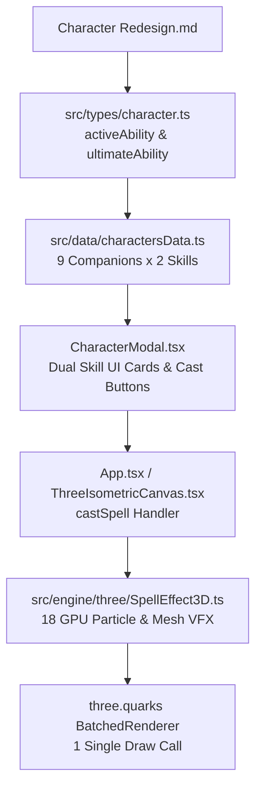

# Plan: Hệ Thống Kỹ Năng & Hiệu Ứng 3D VFX Tái Thiết (Character Redesign)

**Date**: 2026-10-30  
**Slug**: `2026-10-30-character-redesign-skills-vfx`  
**Reference Document**: `plans/261029-1014-isometric-cozy-rpg-friends/Character Redesign.md`  
**Status**: Completed  

---

## 1. Executive Summary

Tái cấu trúc hệ thống kỹ năng của **9 Tri Kỷ**, chuyển đổi từ mô hình 1 tuyệt kỹ đơn điệu sang mô hình chuẩn RPG: **1 Kỹ Năng Chủ Động (Active Skill - Hồi chiêu nhanh, tác chiến chiến thuật)** và **1 Kỹ Năng Tối Thượng (Ultimate Skill - Tuyệt chiêu nộ, hiệu ứng mãn nhãn đảo chiều trận đấu)**.

Kế hoạch này mở rộng toàn diện:
1. **Data Model**: Chuẩn hóa `activeAbility` và `ultimateAbility` trong `src/types/character.ts` và cập nhật dữ liệu 9 nhân vật trong `src/data/charactersData.ts`.
2. **GPU-Batched VFX Engine (`SpellEffect3D.ts`)**: Tận dụng `three.quarks` và Three.js procedural meshes để tạo 18 hiệu ứng 3D độc bản (rễ cây đại ngàn, mưa sao băng pháo hoa, vệt cọ hư không, sóng âm ca hát, giếng phun nước nóng, khiên dòng suối, v.v.).
3. **UI & Combat Interaction**: Nâng cấp Tab Kỹ Năng trong `CharacterModal.tsx` để hiển thị 2 kỹ năng riêng biệt với icon, thời gian hồi chiêu, và 2 nút thi triển độc lập.
4. **Performance & Audio**: Tích hợp SFX cho từng kỹ năng và kiểm tra ngân sách hiệu năng di động (<5 draw calls, 60 FPS).

---

## 2. Phased Execution Roadmap

| Phase | Title | Scope & Deliverables | Est. Effort |
| :--- | :--- | :--- | :--- |
| **Phase 1** | **Data Model & Schema Migration** | Định nghĩa `CharacterAbility` & `AbilityType` trong `src/types/character.ts`; cập nhật toàn bộ 9 nhân vật trong `src/data/charactersData.ts`. | 1.5h |
| **Phase 2** | **18-Spell 3D VFX Engine** | Xây dựng 9 Active VFX + 9 Ultimate VFX trong `SpellEffect3D.ts` bằng `three.quarks` particle systems và Three.js geometry. | 3.0h |
| **Phase 3** | **Dual Ability UI & Canvas Integration** | Cập nhật `CharacterModal.tsx`, `App.tsx`, và `ThreeIsometricCanvas.tsx` để hỗ trợ thi triển cả 2 kỹ năng độc lập. | 1.5h |
| **Phase 4** | **SFX & Performance Verification** | Tích hợp audio triggers trong `audioManager.ts`, kiểm tra tải hạt di động và xác thực build `npm run build`. | 1.0h |

---

## 3. Architecture & Data Flow

---

## 4. Danh Sách 18 Kỹ Năng Cần Tạo Hiệu Ứng

| # | Nhân Vật | Kỹ Năng Chủ Động (Active) | Kỹ Năng Tối Thượng (Ultimate) |
| :-: | :--- | :--- | :--- |
| **1** | **Huỳnh Trần Anh Thi** | **Hạt Giống Sinh Mệnh** (`active_seed_of_life`): Ném hạt thông nảy mầm, tỏa sương mù hồi máu HoT. | **Đại Ngàn Tỉnh Giấc** (`ult_forest_awakening`): Rễ cây khổng lồ trồi lên trói chân địch, thảm hoa nở rộ buff giáp. |
| **2** | **Lê Nguyễn Phương Quỳnh** | **Mũi Tên Âm Vang** (`active_resonating_arrow`): Mũi tên âm thanh xuyên thấu đường thẳng khóa chiêu. | **Khúc Ca Đại Ngàn** (`ult_hymn_of_wilds`): Giọng hát vang dội tạo sóng âm mê hoặc (Charm) và buff 50% sát thương/tốc đánh. |
| **3** | **Trần Nguyễn Trâm Anh** | **Vệt Cọ Hư Không** (`active_void_brush`): Vung cọ vẩy vệt màu hư không hình nón gây mù và sát thương. | **Kiệt Tác Không Gian** (`ult_spatial_masterpiece`): Biến chiến trường thành bức tranh sơn dầu, tàng hình đồng minh và debuff địch. |
| **4** | **Nguyễn Khải Văn** | **Quả Cầu Pháo Hoa** (`active_firework_orb`): Cầu lửa ngưng tụ nổ tung thành hoa lửa rực rỡ và thiêu đốt. | **Dạ Khúc Tinh Tú** (`ult_celestial_nocturne`): Mưa pháo hoa sao băng giáng từ trên cao diện rộng, hất tung kẻ địch. |
| **5** | **Nguyễn Trần Thảo Uyên** | **Ánh Sáng Chở Che** (`active_guardian_light`): Khiên thái dương bảo hộ hấp thụ đòn và thanh tẩy debuff. | **Hừng Đông Tỏa Sáng** (`ult_dawn_resurgence`): Cột sáng bình minh hồi đầy máu, hồi sinh đồng minh và làm mù toàn map. |
| **6** | **Nguyễn Thị Ngọc Hà** | **Nhịp Độ Thể Thao** (`active_athletic_tempo`): Lướt nhanh tung 3 cú đá liên hoàn cộng dồn tốc độ và né tránh. | **Chân Ngôn Bất Tận** (`ult_infinite_flurry`): Reset cooldown cơ động, bật nhảy liên tục giáng bão đòn nện đất AOE. |
| **7** | **Phạm Trần Thanh Phương** | **Dòng Suối Quật Cường** (`active_resilient_torrent`): Khiên nước núi đá hấp thụ đòn và nổ tung đẩy lùi địch. | **Khát Vọng Trùng Khơi** (`ult_ocean_tsunami`): Biến địa hình thành biển cuộn sóng, khiêu khích (Taunt) và quét sóng thần cực đại. |
| **8** | **Phạm Xuân Minh** | **Lệnh Xung Phong** (`active_fearless_charge`): Lao thẳng cắm dấu ấn mục tiêu, đòn đánh đồng đội vào mục tiêu hồi máu. | **Bữa Tiệc Cuồng Nộ** (`ult_party_frenzy`): Lướt chém liên hoàn sấm sét, buff toàn đội 100% tốc chạy và kháng khống chế. |
| **9** | **Lâm Anh Thư** | **Làn Sóng Tĩnh Lặng** (`active_serene_wave`): Luồng nước dịu êm nảy qua lại giữa 3 đồng minh không gây aggro. | **Nhiệt Huyết Đại Dương** (`ult_passionate_geyser`): Cột nước phun trào khổng lồ hồi đầy máu và cấp khiên bong bóng nổ. |

---

## 5. Verification & Acceptance Criteria

1. **Compilation**: `npm run build` hoàn thành không lỗi TypeScript (`tsc && vite build`).
2. **Data Model**: Cả 9 nhân vật hiển thị đầy đủ Active Skill và Ultimate Skill với tên, mô tả, hồi chiêu và icon.
3. **3D Visuals**: Cả 18 kỹ năng kích hoạt mượt mà trên canvas isometric với hiệu ứng hạt batched và point light phù hợp.
4. **UI**: Tab Kỹ Năng trong Modal có 2 card kỹ năng trực quan, bấm thi triển phát âm thanh và tạo hiệu ứng tại vị trí nhân vật.
