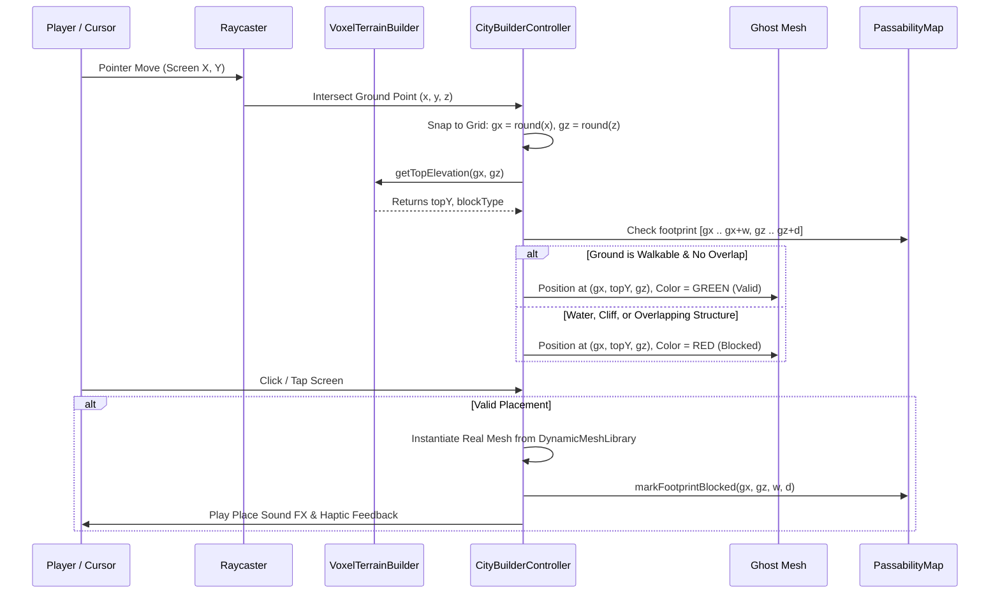

# Phase 3: Grid Placement, Ghost Hologram & Removal (Bulldozer)

## 1. Objective

Implement the core construction mechanics adapted from Kenney's `builder.gd`:
1. Pointer-to-terrain grid raycasting.
2. Real-time **Ghost Preview Hologram** with dynamic color validity shaders (Emerald Green vs Crimson Red).
3. $90^\circ$ structure rotation.
4. Definitive structure placement updating both the Three.js scene and `passabilityMap.ts`.
5. **Bulldozer / Demolish Mode** to remove structures and restore terrain passability.

---

## 2. Placement & Validation Engine (`CityBuilderController.ts`)



---

## 3. Implementation Steps

1. **Grid Calculation & Raycasting**:
   - Create `src/engine/three/builder/CityBuilderController.ts`:
     ```typescript
     public onPointerMove(normalizedX: number, normalizedY: number): void {
       this.raycaster.setFromCamera({ x: normalizedX, y: normalizedY }, this.camera);
       const hit = this.raycaster.intersectObject(this.terrainPlane);
       if (!hit || hit.length === 0) return;
       
       const worldPos = hit[0].point;
       const gridX = Math.round(worldPos.x);
       const gridZ = Math.round(worldPos.z);
       this.updateGhostPosition(gridX, gridZ);
     }
     ```
2. **Ghost Hologram Material**:
   - Custom `MeshBasicMaterial` with:
     ```typescript
     const validMat = new THREE.MeshBasicMaterial({ color: 0x20c997, transparent: true, opacity: 0.65, wireframe: false });
     const invalidMat = new THREE.MeshBasicMaterial({ color: 0xfa5252, transparent: true, opacity: 0.65, wireframe: false });
     ```
   - Traversing the ghost mesh hierarchy to apply the tint while preserving object outlines.
3. **Footprint Passability Synchronization**:
   - In `passabilityMap.ts`, add methods to reserve and release bounding cells:
     ```typescript
     public markCustomObstacle(minX: number, maxX: number, minZ: number, maxZ: number, blocked: boolean): void
     ```
   - This ensures companions immediately pathfind around user-placed houses, walls, and fences.
4. **Demolish Mode (Bulldozer Tool)**:
   - When tool is set to `'demolish'`:
     - Hide the building ghost.
     - Raycasting detects instances inside `userStructuresGroup`.
     - Hovered structure pulses with a red bounding outline.
     - Clicking the hovered structure calls `removeStructure(instanceId)`, removes it from the Three.js scene, disposes of its clone geometry references, unblocks its footprint in `passabilityMap`, and plays a stone/wood crumbling sound.
5. **Sound Effects**:
   - In `audioManager.ts`, synthesize pleasant FM audio chimes for `playBuildSuccess()` and `playDemolishSound()`.

---

## 4. Acceptance Criteria

- Moving cursor or finger across the map snaps the ghost mesh to exact 1-meter integer coordinates.
- Ghost preview turns red when hovering over the ocean ($Y \le 0$) or existing village buildings.
- Pressing `R` or `Space` rotates the ghost preview by $90^\circ$ clockwise.
- Clicking on valid ground places the structure instantly without frame drop.
- Bulldozer mode successfully highlights and deletes placed objects.
- Companions walk around newly placed buildings rather than passing through them.
