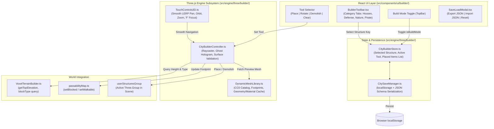

# City Builder Mode: In-Game Construction, Smooth Camera, Dynamic MeshLibrary & Persistence

## 1. Executive Summary

This plan adapts the core mechanics of [Kenney's Starter Kit City Builder](https://github.com/KenneyNL/Starter-Kit-City-Builder) into **Haven of Companions** (*Làng Tri Kỷ*) as a native WebGL Three.js subsystem. Rather than introducing a secondary engine or heavy WebAssembly bridge, it translates Godot's `builder.gd` and `MeshLibrary` architecture into an idiomatic, high-performance TypeScript/Three.js sandbox:

1. **Building & Removing Structures (Placement, Ghost Hologram, Demolish)**:
   - Grid-snapped pointer raycasting onto the $70 \times 70$ voxel terrain via `VoxelTerrainBuilder.getTopElevation(x, z)`.
   - Semi-transparent **Ghost Preview Hologram** with real-time green/red validity checking (validates against water $Y \le 0$, steep slopes, companion pedestals, and existing structures).
   - $90^\circ$ clockwise rotation via keyboard shortcuts (`R`, `Space`) or UI rotate button.
   - **Bulldozer / Demolish Mode** to highlight and delete placed structures with visual feedback and sound effects.
2. **Smooth Camera Controls (Builder Mode)**:
   - Dedicated camera control profile with inertia-based LERP damping for pan, orbit, and zoom.
   - Keyboard shortcuts (`W/A/S/D` pan, `Q/E` orbit, `F` center on cursor/plaza).
   - Bounds clamping ($X, Z \in [-34, 34]$) preventing camera loss over the deep ocean.
3. **Dynamic MeshLibrary Asset Registry & CC0 Models**:
   - Centralized `DynamicMeshLibrary.ts` indexing CC0 models from KayKit Medieval and Kenney Pirate packs (residential cottages, defense watchtowers, windmills, market stalls, palms, fences, pirate cannons, chests).
   - Footprint collision metrics ($1 \times 1, 2 \times 2, 3 \times 3$), elevation offsets, and material/geometry caching.
   - 2D SVG / Sprite icon generation for the UI building drawer.
4. **Saving & Loading (Persistence)**:
   - Automated serialization of custom town layouts to browser `localStorage` (`haven_city_layout_v1`).
   - Instant restore upon game load; JSON export/import for sharing village designs.
   - Dynamic synchronization with `passabilityMap.ts` so companion pathfinding respects user-built structures.
5. **Target Performance ($\ge 30\text{ FPS}$ Mobile)**:
   - Shared geometries and materials via `DynamicMeshLibrary` to minimize WebGL draw calls.
   - Adaptive frame-rate pacing: throttle to $30\text{ FPS}$ during idle/mobile battery saving, up to $60\text{ FPS}$ during active placement.
   - Maximum placed structure cap ($100$ items) with automatic memory cleanup.

---

## 2. Architecture & Data Flow

---

## 3. Phased Execution Roadmap

| Phase | Title | Scope & Deliverables | Primary Files |
| :--- | :--- | :--- | :--- |
| **Phase 1** | **Dynamic MeshLibrary Asset Registry & CC0 Models** | Build `DynamicMeshLibrary.ts` indexing CC0 models from KayKit & Kenney; define footprints, pivot offsets, categories, and cached template clones. | `src/engine/three/builder/DynamicMeshLibrary.ts` `src/types/cityBuilder.ts` |
| **Phase 2** | **Smooth Builder Camera Controls & Navigation** | Upgrade `TouchControls3D.ts` with builder mode profile, LERP inertia damping, `W/A/S/D` pan, `Q/E` orbit, and `F` focus key. | `src/engine/three/TouchControls3D.ts` `src/components/canvas/ThreeIsometricCanvas.tsx` |
| **Phase 3** | **Grid Placement, Ghost Hologram & Removal (Bulldozer)** | Implement `CityBuilderController.ts`: raycasting on voxels, green/red ghost preview, $90^\circ$ rotation, placement, and demolish tool with sound FX. | `src/engine/three/builder/CityBuilderController.ts` `src/engine/map/passabilityMap.ts` |
| **Phase 4** | **Save/Load System & LocalStorage Persistence** | Implement `CitySaveManager.ts`: auto-saving to `localStorage`, auto-restoring on game launch, JSON import/export, and map reset. | `src/engine/three/builder/CitySaveManager.ts` `src/components/canvas/ThreeIsometricCanvas.tsx` |
| **Phase 5** | **UI Building Catalog, Sprites & Toolbar Drawer** | Create React UI components: bottom-docked drawer with category tabs, 2D sprite cards, tool switchers, and save/load modal. | `src/components/ui/builder/BuilderToolbar.tsx` `src/components/ui/builder/SaveLoadModal.tsx` `src/components/ui/TopBar.tsx` |
| **Phase 6** | **30+ FPS Performance & Mobile Verification** | Implement geometry/material sharing, 100-structure cap, test mobile touch interactions, verify $>30\text{ FPS}$ on throttled CPU, update docs and changelog. | `src/engine/three/builder/CityBuilderController.ts` `CHANGELOG.md` |

---

## 4. Key Performance & Quality Standards

- **Frame Rate Target**: Stable $\ge 30\text{ FPS}$ under active placement on mobile devices (iPhone/Android), $60\text{ FPS}$ on desktop.
- **Draw Call Discipline**: Cloned structures reuse shared PBR materials and geometry buffers from `DynamicMeshLibrary`.
- **Zero Companion Clipping**: When a structure is placed, its grid bounding box is registered in `passabilityMap.ts` as `cliff` (blocked), preventing companions from walking through walls.
- **Save Integrity**: Corrupted `localStorage` data fails gracefully without breaking diorama initialization.
