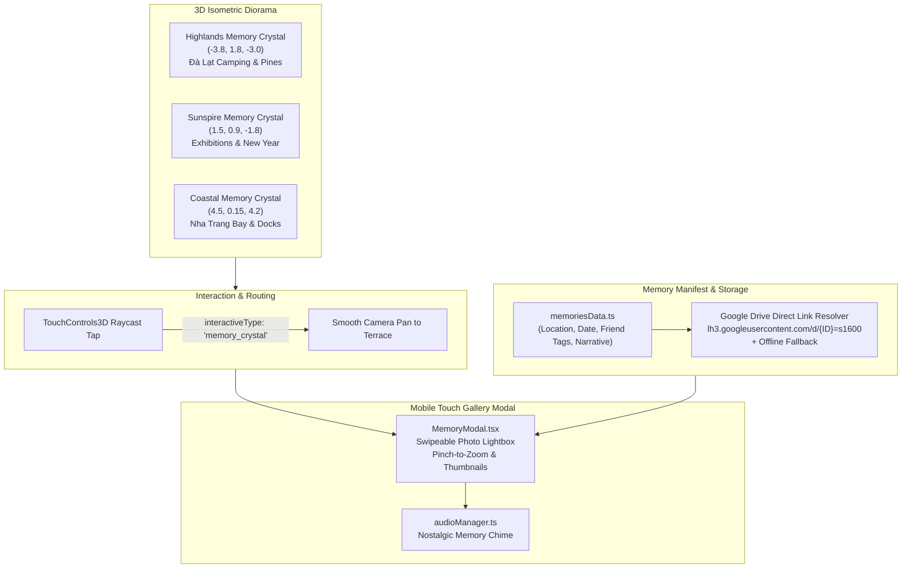

# Interactive Memory Gallery & Photo Review System (*Kho Tàng Kỷ Niệm*)

## Overview

Expand the **Haven of Companions (*Làng Tri Kỷ*)** 3D diorama with an interactive **Memory & Photo Review System**. Players explore the 3D village and tap mystical **Ancient Memory Crystals** placed across the three regional terraces (Highlands Pine Forest, Sunspire Plaza, and Eastern Coastal Harbor) or open memories directly from a companion's sheet. 

Tapping a memory anchor opens a full-screen, mobile-friendly **Memory Photo Gallery Modal (`MemoryModal.tsx`)** showcasing real-life photos (via Google Drive direct links or local assets), dates, location tags, nostalgic journal entries, and tagged companions, set to warm acoustic lofi chimes.

---

## Architecture & Technology Decisions

1. **Storage & Linking Strategy (Zero-Auth Google Drive Direct Links)**:
   - Due to Google's March 31, 2025 shutdown of background Google Photos reading (`photoslibrary.readonly`), we avoid fragile OAuth tokens that expire every 60 minutes.
   - We utilize Google Drive shared file IDs resolved to high-speed CDN direct image URLs (`https://lh3.googleusercontent.com/d/{FILE_ID}=s1600`) paired with local placeholder assets (`public/memories/`) to guarantee instantaneous offline availability.
2. **3D In-World Memory Crystals (`DioramaBuilder.ts`)**:
   - Distinct, glowing procedural crystals (iridescent floating octahedrons with glowing runic pedestals and particle dust) positioned in each of the 3 diorama biomes.
   - Fully integrated into `TouchControls3D.ts` raycasting with golden hover aura.
3. **Touch-First Mobile UI (`MemoryModal.tsx`)**:
   - Engineered for mobile Safari and Android Chrome: 1-finger horizontal swipe between photos, pinch-to-zoom on details, thumbnail rail, friend chips with instant filter, and keyboard arrow navigation on desktop.
4. **Companion Sheet Integration**:
   - A dedicated **"Kỷ Niệm" (Memories)** button inside `CharacterModal.tsx` allows jumping straight from any companion's profile to the memory album featuring them.

---

## Goals

| # | Goal | Priority |
|---|------|----------|
| 1 | Create typed memory schema & extensible data manifest with Google Drive resolution | P1 |
| 2 | Add 3D interactive Memory Crystals with glowing shaders across the 3 diorama terraces | P1 |
| 3 | Build responsive mobile Photo Lightbox & Gallery Modal with swipe, zoom, and friend filters | P1 |
| 4 | Integrate nostalgic audio cues, offline PWA caching, and verify production deployment | P1 |

---

## Phases

| # | Phase | Status |
|---|-------|--------|
| 1 | [Phase 1: Data Schema & Manifest](./phase-01-data-schema-manifest.md) | Pending |
| 2 | [Phase 2: 3D In-World Memory Crystals](./phase-02-3d-memory-crystals.md) | Pending |
| 3 | [Phase 3: Mobile Memory Gallery Modal](./phase-03-memory-gallery-modal.md) | Pending |
| 4 | [Phase 4: Polish, Audio & Verification](./phase-04-polish-audio-verification.md) | Pending |

---

## Success Criteria

- [ ] All 3 diorama terraces feature distinct, glowing 3D Memory Crystals that respond to user taps.
- [ ] Tapping any crystal smoothly pans the camera and opens the `MemoryModal` displaying curated photos from that terrace.
- [ ] Players can swipe through photos, tap thumbnails, read nostalgic captions, and see tagged companions.
- [ ] Tapping "Kỷ Niệm" in any companion's character sheet opens the memory gallery filtered to that friend.
- [ ] Google Drive direct image links render cleanly with automatic offline fallback placeholders.
- [ ] Soft nostalgic audio chime plays upon opening memories without audio lag.
- [ ] 60 FPS performance maintained on mobile devices during transitions; production build passes and deploys to Netlify.

<!-- slug: memory-gallery -->
