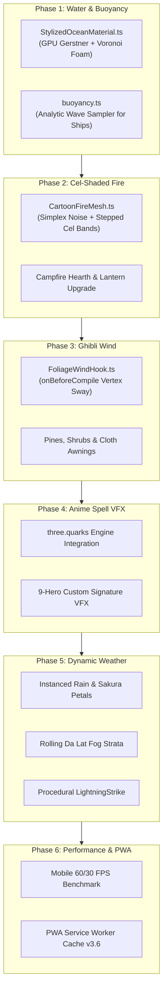

# Zelda & Japanese Anime Stylized Environmental Animation, VFX & Weather

## Overview

This plan modernizes the interactive 3D diorama of **Haven of Companions (*Làng Tri Kỷ*)** with a cohesive Japanese anime & *The Legend of Zelda: Wind Waker / Breath of the Wild* aesthetic. It replaces CPU-bound loops with high-performance GPU shaders, integrates the open-source `three.quarks` particle engine, injects elevation-weighted wind sway into trees and banners, and adds an instanced dynamic weather system with procedural lightning.

All implementations draw directly from battle-tested, free open-source repositories and CC0 asset packs (MIT, Apache 2.0, CC0) documented in `docs/environmental-animation-vfx-guide.md`.

---

## Phases

| Phase | Name | Status | Key Deliverables |
|---|---|---|---|
| 1 | [Zelda Stylized Ocean & Coupled Ship Buoyancy](./phase-01-zelda-stylized-ocean.md) | Completed | GPU Gerstner waves, Voronoi foam, faceted normals, ship roll/heave math |
| 2 | [Cel-Shaded Anime Fire & Hearth System](./phase-02-cel-shaded-anime-fire.md) | Completed | 3D flame cylinder with noise & toon thresholds, drifting embers, campfire hook |
| 3 | [Ghibli Wind & Foliage Vertex Sway](./phase-03-ghibli-wind-foliage-sway.md) | Completed | `onBeforeCompile` wind displacement for pines, shrubs, banners, hanging lanterns |
| 4 | [Fantasy Skill VFX Engine (`three.quarks`)](./phase-04-fantasy-skill-vfx-engine.md) | Completed | `three.quarks` batched renderer, CC0 Kenney textures, 9-hero custom spells |
| 5 | [Dynamic Weather & Storm Atmospheric Controller](./phase-05-dynamic-weather-storm-controller.md) | Completed | Instanced rain & sakura petals, rolling fog planes, procedural lightning flash |
| 6 | [Mobile Performance Profiling & Production Verification](./phase-06-performance-mobile-verification.md) | Completed | $\le 45$ draw calls, 60/30 FPS adaptive loop, PWA cache bump (`v8.3`), build pass |

---

## Architectural & Aesthetic Invariants

1. **Zelda / Anime Cel-Shaded Cohesion**:
   - Hard stepped color boundaries (`step()` / narrow `smoothstep()`) for foam, fire, and specular highlights rather than muddy realistic gradients.
   - Screen-space derivative normals (`dFdx`/`dFdy`) to maintain faceted low-poly diorama edges on water surfaces.
2. **Zero-CPU Render Loop**:
   - Completely eliminate `posAttr.needsUpdate = true` and `computeVertexNormals()` in the per-frame animation loop. All wave elevation and foam calculations occur in GPU vertex/fragment shaders.
3. **Analytic Buoyancy**:
   - Floating ships and boats sample the exact wave equation in JavaScript without reading GPU buffers, eliminating PCIe readback latency.
4. **Draw Call Cap**:
   - The entire diorama scene (environment + 9 heroes + active spell particles + weather precipitation) must remain $\le 45$ draw calls.
5. **Mobile Battery & PWA Safety**:
   - Maximum device pixel ratio capped at 2.0. Adaptive throttling drops to 30 FPS during idle periods. Service worker cache incremented to `v3.6` to guarantee instant client updates.

---

## Success Criteria

- [x] CPU wave loop in `ThreeIsometricCanvas.tsx` is eliminated; ocean runs on `StylizedOceanMaterial`.
- [x] Large galleon ship and rowboat pitch and roll in exact synchronization with wave crests.
- [x] Campfire hearth features animated 3D cel-shaded flames with rising ember particles.
- [x] Highland pine trees, tea pavilion vegetation, and market awnings sway organically with global wind.
- [x] `three.quarks` particle engine powers signature abilities for all 9 heroes with a single batched draw call.
- [x] Weather system supports Clear Sun, Đà Lạt Highland Mist, Coastal Rain/Thunderstorm, and Sakura Petal Breeze.
- [x] Build succeeds with zero TypeScript or Vite errors (`npm run build`).
- [x] Mobile WebGL2 operates at stable 60 FPS during interactions and 30 FPS in idle state.
