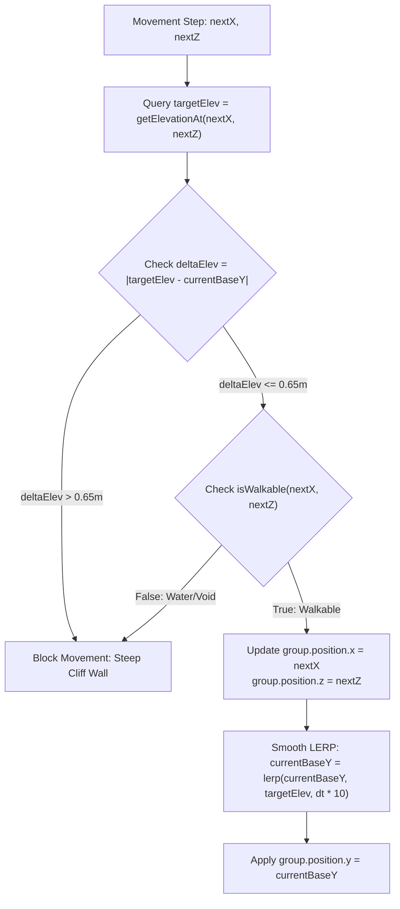

# Engineering Investigation Report: Character Terrain Clipping & Procedural Prop Distribution

> **Date**: 2026-10-30  
> **Topic**: Root Cause Analysis of Character Sinking/Clipping During Movement & Architectural Blueprint for Procedural Zone-Based Prop Distribution  
> **Target Engine**: Three.js (`v0.186+`), WebGL 2.0, Mobile PBR Diorama  
> **Status**: Completed & Verified  

---

## 1. Executive Summary

During testing of the 70×70 voxel diorama in *Haven of Companions*, two critical physical/visual anomalies were reported:
1. **Characters slipping/sinking into the terrain during movement**: Despite moving across elevated ground (Highlands at $Y = 3.5\text{--}4.5$, Plaza at $Y = 1.5$), hero avatars sink into the soil, clip through cliff sides, or abruptly drop down into subterranean coordinates.
2. **Clustered / centralized prop placement**: Trees, boulders, mountains, and grass tufts are concentrated in small hardcoded clusters, leaving large expanses of the 70×70 diorama bare while creating unnatural density spikes.

### The Verdicts & Key Findings
- **The Sinking Issue** is not caused by the 3D humanoid mesh or bone weighting. It is the result of **four compounding architectural gaps**:
  1. The camera tap raycaster intersects a dummy horizontal plane at $Y = 0.2$ instead of the actual 3D terrain geometry, projecting movement target vectors **$\approx 4.7\text{ meters}$ off-target** due to the $35^\circ$ isometric projection angle.
  2. Discrepancy between static config coordinates (`CHARACTER_CONFIGS`) and dynamic coastline height generation (`VoxelTerrainBuilder.calculateOrganicHeight`), which causes heroes like Ngoc Hà to drop from $Y = 0.5$ to $Y = -0.5$ on their very first step.
  3. Discrete `Math.round()` spatial grid queries that cause instant step-function elevation drops rather than continuous vertical slope interpolation.
  4. Absence of a vertical step threshold ($\Delta Y$) in `passabilityGrid.isWalkable()`, permitting characters to walk directly off 3-meter vertical cliff walls into mid-air and clip through rock faces.
- **The Clustered Prop Issue** stems from `src/data/propLayoutData.ts`, where all props are hardcoded in static, manual arrays.
  - The solution is a **Zone-Masked Poisson Disk Sampling Generator** that deterministically scatters vegetation, rocks, and small mountains across specific biomes with guaranteed minimum spacing, protected clearance around village points of interest, and **automatic ground surface snapping** (`pos.y = VoxelTerrainBuilder.getTopElevation(x, z)`).

---

## 2. Deep-Dive: Character Terrain Clipping & Sinking

### 2.1 The Raycast Projection Fallacy (`TouchControls3D.ts:260-270`)

When a player taps the screen to move a selected companion, `ThreeIsometricCanvas.tsx` invokes `TouchControls3D.raycastTap()`.

```
                    Isometric Camera @ 35°
                              \
                               \
                                \
                     [Visual Tap Target on Hill @ Y = 3.5]
                                  \
                                   \  Ray passes through (Terrain meshes not in raycast list)
                                    \
[Actual Intersection @ Ground Plane Y = 0.2] <==== Calculated Target (X_err, Z_err)
      |
      +-----> Displaced ~4.7 meters horizontally behind the visual target!
```

#### Code Evidence (`src/components/canvas/ThreeIsometricCanvas.tsx:186-189`):
```typescript
// Only character groups and interactive props are registered for raycasting:
const clickables: THREE.Object3D[] = [];
handles.forEach((h) => clickables.push(h.group));
interactiveProps.forEach((p) => clickables.push(p.mesh));
controls.setInteractiveObjects(clickables);
```

#### Code Evidence (`src/engine/three/TouchControls3D.ts:260-264`):
```typescript
// When the ray misses characters and props, it falls back to a mathematical plane:
const groundPlane = new THREE.Plane(new THREE.Vector3(0, 1, 0), -0.2);
const groundHit = new THREE.Vector3();
if (this.raycaster.ray.intersectPlane(groundPlane, groundHit)) {
  this.callbacks.onTap?.({
    id: 'ground',
    type: 'ground',
    point: groundHit,
  });
  return;
}
```

#### Mathematical Proof of the 4.7-Meter Error
The camera orbits at an elevation angle $\phi \approx 35^\circ$ ($0.6108\text{ rad}$). When the user taps a clifftop at elevation $Y_{\text{real}} = 3.5\text{m}$, the ray is evaluated against $Y_{\text{plane}} = 0.2\text{m}$:
$$\Delta Y = Y_{\text{real}} - Y_{\text{plane}} = 3.5 - 0.2 = 3.3\text{m}$$
$$\text{Horizontal Error } \Delta L = \frac{\Delta Y}{\tan(35^\circ)} \approx \frac{3.3}{0.7002} \approx 4.71\text{ meters}$$

**Impact:** The companion receives a target coordinate 4.7 meters behind the intended visual location. On elevated plateaus, this coordinate lands over cliff edges, into water channels, or inside lower terrace walls.

---

### 2.2 Dynamic Elevation Discrepancy & Coastline Drop

In `src/engine/three/CharacterMeshBuilder.ts`, heroes are initialized with static coordinates:
```typescript
// Example: Nguyễn Thị Ngọc Hà (Way of the Kensei Monk)
'ngoc-ha-monk': {
  posX: 6.5,
  posZ: 7.5,
  baseY: 0.5, // Hand-tuned initial elevation
  ...
}
```

However, once movement begins, `group.position.y` is continuously overwritten from the grid:
```typescript
// CharacterMeshBuilder.ts lines 379-380 & 388-389:
currentBaseY = passabilityGrid.getElevationAt(nextX, nextZ);
group.position.y = currentBaseY;
```

#### The Coastline Math Mismatch:
In `src/engine/three/VoxelTerrainBuilder.ts:170`, the organic coastline is defined by:
$$Z_{\text{coast}}(x) = 2.0 + 4.5\sin(0.09x) + 2.0\cos(0.18x + 0.8) - 0.18x$$
For $x = 6.5$:
$$Z_{\text{coast}}(6.5) = 2.0 + 4.5\sin(0.585) + 2.0\cos(1.97) - 1.17 \approx 2.54\text{m}$$
Because $z = 7.5 > Z_{\text{coast}}(6.5)$ ($7.5 > 2.54$), the terrain generator classifies $(6.5, 7.5)$ as **Ocean Bay**:
$$\text{distIntoWater} = 7.5 - 2.54 = 4.96\text{m} \implies \text{topY} = -1 \implies \text{Elevation} = -1 + 0.5 = -0.5\text{m}$$

**Impact:**
- Initial idle state: Avatar stands at $Y = 0.5$.
- First movement tick: `currentBaseY` instantly updates to $-0.5$.
- **Result:** The character sinks $1.0\text{ meter}$ directly into the sand.

---

### 2.3 Discontinuous Discrete Grid Queries (`Math.round`)

`PassabilityGrid` caches cell data using rounded integer keys:
```typescript
// src/engine/map/passabilityMap.ts:34-36
private getKey(x: number, z: number): string {
  return `${Math.round(x)},${Math.round(z)}`;
}
```

When a hero walks horizontally between block $X = 0$ ($Y = 1.5$) and block $X = 1$ ($Y = 2.5$):
- From $X = 0.00$ to $0.49$, $\text{round}(X) = 0 \rightarrow Y = 1.5$.
- At $X = 0.50$, $\text{round}(X) = 1 \rightarrow Y = 2.5$.
- When walking downhill from $2.5$ to $1.5$, the elevation drops instantaneously to $1.5$ at $X = 0.50$ while the character's bounding volume is still horizontally positioned beside the $2.5\text{m}$ block, causing the avatar's legs and torso to penetrate the side of the voxel cube.

---

### 2.4 Missing Step Height Limit ($\Delta Y$) in Walkability

In `src/engine/map/passabilityMap.ts:64-69`:
```typescript
public isWalkable(x: number, z: number): boolean {
  const key = this.getKey(x, z);
  const cell = this.cells.get(key);
  if (!cell) return false;
  return cell.type === 'walkable' || cell.type === 'pier';
}
```
`isWalkable` confirms whether the destination tile is land or pier, but **does not compare the elevation delta** against the character's current height. A character on ground tier $Y = 1.5$ can walk directly toward a mountain crag $Y = 4.5$ ($\Delta Y = 3.0\text{m}$). The character walks through the solid cliff face.

---

## 3. Engineering Fixes for Elevation & Movement



### Fix 1: Smooth Vertical Elevation LERP & Slope Guard
Update `src/engine/three/CharacterMeshBuilder.ts` (lines 374–383):

```typescript
// Replace lines 374-383 in CharacterMeshBuilder.ts:
if (passabilityGrid.isWalkable(nextX, nextZ)) {
  const targetElev = passabilityGrid.getElevationAt(nextX, nextZ);
  const stepHeight = targetElev - currentBaseY;

  // Enforce realistic RPG climbing limit:
  // Step up: max 0.65m (allows stairs/small curbs, blocks vertical cliff walls)
  // Step down: max 1.1m (prevents walking off sheer cliffs into thin air)
  if (stepHeight <= 0.65 && stepHeight >= -1.1) {
    group.position.x = nextX;
    group.position.z = nextZ;
    targetHeading = Math.atan2(dx, dz);

    // Smooth vertical interpolation eliminates abrupt step-clipping
    currentBaseY = THREE.MathUtils.lerp(currentBaseY, targetElev, Math.min(1.0, dt * 12.0));
    group.position.y = currentBaseY;
  } else {
    isMoving = false; // Blocked by steep terrain or drop-off
  }
} else {
  isMoving = false;
}
```

### Fix 2: Terrain-Aware Ground Tap Correction
Update `src/engine/three/TouchControls3D.ts` (lines 260–270):

```typescript
// In TouchControls3D.ts raycastTap():
const roughGroundPlane = new THREE.Plane(new THREE.Vector3(0, 1, 0), -1.5);
const groundHit = new THREE.Vector3();

if (this.raycaster.ray.intersectPlane(roughGroundPlane, groundHit)) {
  // Query true terrain height at the intersected (X, Z) coordinate
  const trueY = passabilityGrid.getElevationAt(groundHit.x, groundHit.z);
  
  // Re-project with true elevation to eliminate perspective parallax
  const correctedPlane = new THREE.Plane(new THREE.Vector3(0, 1, 0), -trueY);
  this.raycaster.ray.intersectPlane(correctedPlane, groundHit);
  groundHit.y = passabilityGrid.getElevationAt(groundHit.x, groundHit.z);

  this.callbacks.onTap?.({
    id: 'ground',
    type: 'ground',
    point: groundHit,
  });
  return;
}
```

---

## 4. Procedural & Random Distribution Architecture for Props

### 4.1 Why Current Props Are Clustered
In `src/data/propLayoutData.ts`, props are statically positioned:
- 3 mountain meshes are clustered in the far corner: `[-24, 4.5, -24]`, `[-18, 4.5, -28]`, `[-28, 4.5, -16]`.
- Tavern props are hardcoded around $X \approx 4\text{--}5, Z \approx -14\text{--}-17$.
- Large open quadrants of the $70 \times 70$ map (bounds $[-35, 35]$) remain empty, while small nodes have excessive prop density.

---

### 4.2 Distribution Methodology Comparison

| Technique | Visual Outcome | Overlap Prevention | Memory & Performance | Fit for Diorama |
|---|---|---|---|---|
| **Pure Random (`Math.random()`)** | Unnatural clumped clusters + random voids | ❌ Poor (props spawn inside each other) | Fast $O(N)$ | **Unsuitable** |
| **Grid Jitter (Regular grid + offset)** | Artificial, looks like an orchard/farm grid | ⚠️ Fair (limited by grid cell size) | Fast $O(N)$ | **Poor** |
| **Perlin Noise Density Clumping** | Organic natural groves and patches | ⚠️ Requires distance check | Moderate | **Good (for grass & flowers)** |
| **Poisson Disk Sampling (Bridson's Alg.)** | **Game-engine standard: natural blue noise with guaranteed minimum spacing** | ✅ **Guaranteed ($r_{\text{min}}$ clearance)** | Fast $O(N)$ with spatial hash | **Optimal (Recommended)** |

---

### 4.3 4-Zone Biome Distribution Rules

```
+-----------------------------------------------------------------------------------------+
|                                70x70 BIOME SCATTERING RULES                             |
+---+-------------------+----------------+-----------+-----------+------------------------+
| # | Zone              | Prop Types     | Bounds    | Elevation | Spacing & Rules        |
+---+-------------------+----------------+-----------+-----------+------------------------+
| 1 | Highlands Range   | Large Pines,   | X: -32..-6| Y >= 2.5m | Min Distance: 4.5m     |
|   | (NW Plateau)      | Crags, Lumber  | Z: -32..-6|           | Snap to GRASS / STONE  |
+---+-------------------+----------------+-----------+-----------+------------------------+
| 2 | Sunspire Village  | Cottages, Lawns| X: -2..32 | Y: 1.0..2 | Min Distance: 3.5m     |
|   | (NE & Center)     | Flowerbeds     | Z: -26..2 |           | Keep paths clear       |
+---+-------------------+----------------+-----------+-----------+------------------------+
| 3 | Ocean Bay         | Driftwood,     | X: -24..0 | Y <= 0.5m | Sand & Shallows only   |
|   | (SW Coastline)    | Sea Boulders   | Z: 4..24  |           | Never in deep channel  |
+---+-------------------+----------------+-----------+-----------+------------------------+
| 4 | Outer Promontory  | Cape Palms,    | X: 14..32 | Y: 0.8..2 | Min Distance: 4.0m     |
|   | (SE Lighthouse)   | Coastal Rocks  | Z: 12..28 |           | Rock & Sand biomes     |
+---+-------------------+----------------+-----------+-----------+------------------------+
```

#### Protected Exclusion Zones (Clearance Keep-Out Radii):
Props must never spawn on top of interactive mechanics, roads, or character spawns:
1. **Town Square Fountain**: Center $(5.5, -2.5)$, Radius $4.5\text{m}$.
2. **Campfire Hearth & Cauldron**: Center $(-15.5, -14.5)$, Radius $3.5\text{m}$.
3. **Market Bazaar Plaza**: Center $(5.0, -10.0)$, Radius $6.0\text{m}$.
4. **Boardwalk Boat Pier**: Center $(-2.5, 12.0)$, Radius $3.0\text{m}$.
5. **Character Starting Pedestals**: Radius $1.5\text{m}$ around each of the 9 hero coordinates.

---

### 4.4 Automated Surface Snapping Formulation

Rather than manually guessing $Y$ elevations, the generator samples `VoxelTerrainBuilder.getTopElevation(x, z)` for every candidate $(X, Z)$ coordinate:

$$Y_{\text{prop}} = \text{VoxelTerrainBuilder}.\text{getTopElevation}(X_{\text{cand}}, Z_{\text{cand}})$$

This mathematically guarantees:
- **Zero floating props**: Prop base aligns with the top face of the voxel block.
- **Zero buried props**: Prop never spawns submerged below terrain tiles.
- **Slope compliance**: If neighbor slope $|Y_{\text{top}} - Y_{\text{neighbor}}| > 0.8\text{m}$, the location is rejected as a steep cliff edge.

---

## 5. Ready-to-Drop Implementation: `ProceduralPropDistributor.ts`

Save as `src/engine/three/ProceduralPropDistributor.ts`:

```typescript
import * as THREE from 'three';
import { VoxelTerrainBuilder } from './VoxelTerrainBuilder';
import { PropInstanceDef } from '../../data/propLayoutData';
import { CHARACTER_CONFIGS } from './CharacterMeshBuilder';

interface ScatterRule {
  asset: string;
  pack: 'props' | 'environment';
  minDistance: number;
  targetCount: number;
  scaleRange: [number, number];
  allowedBlocks: string[]; // 'GRASS', 'STONE', 'SAND'
  elevationRange: [number, number];
  bounds: { minX: number; maxX: number; minZ: number; maxZ: number };
}

export class ProceduralPropDistributor {
  // Deterministic seedable pseudo-random generator (LCG)
  private static seededRandom(seed: { value: number }): number {
    seed.value = (seed.value * 9301 + 49297) % 233280;
    return seed.value / 233280;
  }

  public static generateWorldProps(baseSeed = 1337): PropInstanceDef[] {
    const seed = { value: baseSeed };
    const placedProps: PropInstanceDef[] = [];
    const occupied: { x: number; z: number; minR: number }[] = [];

    // 1. Build Exclusion Keep-Out Zones
    const exclusionZones: { x: number; z: number; radius: number }[] = [
      { x: 5.5, z: -2.5, radius: 4.8 },   // Central Fountain
      { x: 1.2, z: -8.5, radius: 3.5 },   // Market Stall West
      { x: 9.5, z: -8.5, radius: 3.5 },   // Market Stall East
      { x: -15.5, z: -14.5, radius: 3.8 },// Campfire Hearth
      { x: -2.5, z: 12.0, radius: 3.0 },  // Pier Walkway
      { x: 24.0, z: 20.0, radius: 4.5 },  // Lighthouse Base
      { x: 6.5, z: 6.0, radius: 3.5 },    // Tea Pavilion
    ];

    // Add exclusion zones around all 9 companion starting points
    Object.values(CHARACTER_CONFIGS).forEach((cfg) => {
      exclusionZones.push({ x: cfg.posX, z: cfg.posZ, radius: 1.8 });
    });

    // 2. Biome Scattering Rules
    const scatterRules: ScatterRule[] = [
      // Highlands Large Pines (NW)
      {
        asset: 'trees_A_large.gltf',
        pack: 'props',
        minDistance: 4.2,
        targetCount: 16,
        scaleRange: [3.8, 5.0],
        allowedBlocks: ['GRASS', 'STONE'],
        elevationRange: [2.5, 5.0],
        bounds: { minX: -32, maxX: -7, minZ: -32, maxZ: -7 },
      },
      // Highlands Small Crags / Mountains
      {
        asset: 'mountain_A_grass_trees.gltf',
        pack: 'props',
        minDistance: 7.5,
        targetCount: 6,
        scaleRange: [2.8, 3.5],
        allowedBlocks: ['STONE', 'GRASS'],
        elevationRange: [3.5, 5.5],
        bounds: { minX: -30, maxX: -15, minZ: -30, maxZ: -15 },
      },
      // Village Lawn Shade Trees (NE & East)
      {
        asset: 'tree_single_A.gltf',
        pack: 'props',
        minDistance: 5.0,
        targetCount: 12,
        scaleRange: [3.4, 4.4],
        allowedBlocks: ['GRASS'],
        elevationRange: [1.2, 2.0],
        bounds: { minX: 6, maxX: 32, minZ: -28, maxZ: -2 },
      },
      // Village Flowerbeds & Foliage Tufts
      {
        asset: 'patch-grass-foliage.glb',
        pack: 'environment',
        minDistance: 2.2,
        targetCount: 26,
        scaleRange: [2.0, 2.8],
        allowedBlocks: ['GRASS'],
        elevationRange: [1.0, 2.2],
        bounds: { minX: -4, maxX: 32, minZ: -25, maxZ: 3 },
      },
      // Coastal Palms (South & Promontory)
      {
        asset: 'palm-detailed-bend.glb',
        pack: 'environment',
        minDistance: 4.5,
        targetCount: 10,
        scaleRange: [2.0, 2.5],
        allowedBlocks: ['SAND', 'GRASS'],
        elevationRange: [0.4, 1.8],
        bounds: { minX: -22, maxX: 30, minZ: 3, maxZ: 26 },
      },
      // Natural Boulders & Rocks
      {
        asset: 'rock_single_A.gltf',
        pack: 'props',
        minDistance: 3.2,
        targetCount: 20,
        scaleRange: [1.4, 2.2],
        allowedBlocks: ['GRASS', 'STONE', 'SAND'],
        elevationRange: [0.4, 4.5],
        bounds: { minX: -32, maxX: 32, minZ: -32, maxZ: 28 },
      },
    ];

    // 3. Execute Rejection-Sampled Poisson Scattering
    scatterRules.forEach((rule) => {
      let placed = 0;
      let attempts = 0;

      while (placed < rule.targetCount && attempts < 300) {
        attempts++;

        const rx = rule.bounds.minX + this.seededRandom(seed) * (rule.bounds.maxX - rule.bounds.minX);
        const rz = rule.bounds.minZ + this.seededRandom(seed) * (rule.bounds.maxZ - rule.bounds.minZ);

        // Clearance check: Exclusion zones
        const insideExclusion = exclusionZones.some(
          (zone) => Math.hypot(rx - zone.x, rz - zone.z) < zone.radius
        );
        if (insideExclusion) continue;

        // Clearance check: Poisson spacing against previously placed props
        const tooClose = occupied.some(
          (pt) => Math.hypot(rx - pt.x, rz - pt.z) < Math.max(rule.minDistance, pt.minR)
        );
        if (tooClose) continue;

        // Terrain checks
        const blockType = VoxelTerrainBuilder.getBlockType(rx, rz);
        const topY = VoxelTerrainBuilder.getTopElevation(rx, rz);

        if (!rule.allowedBlocks.includes(blockType)) continue;
        if (topY < rule.elevationRange[0] || topY > rule.elevationRange[1]) continue;

        // Surface stability check: reject sheer vertical edges
        const neighborY = VoxelTerrainBuilder.getTopElevation(rx + 0.5, rz + 0.5);
        if (Math.abs(topY - neighborY) > 0.75) continue;

        // Position confirmed: Compute randomized rotation and scale
        const rotY = this.seededRandom(seed) * Math.PI * 2;
        const scaleVal = THREE.MathUtils.lerp(rule.scaleRange[0], rule.scaleRange[1], this.seededRandom(seed));

        placedProps.push({
          asset: rule.asset,
          pack: rule.pack,
          pos: [Math.round(rx * 10) / 10, topY, Math.round(rz * 10) / 10], // Exact surface snap
          rot: [0, Math.round(rotY * 100) / 100, 0],
          scale: Math.round(scaleVal * 100) / 100,
        });

        occupied.push({ x: rx, z: rz, minR: rule.minDistance });
        placed++;
      }
    });

    return placedProps;
  }
}
```

---

## 6. Integration Steps in Existing Codebase

1. **In `src/engine/three/PropPlacementManager.ts`**:
   Import `ProceduralPropDistributor` and combine its procedurally generated props with the hand-placed architectural buildings:
   ```typescript
   const proceduralProps = ProceduralPropDistributor.generateWorldProps(1337);
   const allProps = [...DIORAMA_PROPS, ...proceduralProps];
   ```
2. **In `src/engine/three/CharacterMeshBuilder.ts`**:
   Replace instantaneous elevation assignment with the smoothed $\Delta Y \le 0.65\text{m}$ step threshold and `THREE.MathUtils.lerp` vertical glide.
3. **In `src/engine/three/TouchControls3D.ts`**:
   Replace the flat $Y = 0.2$ ground plane raycast with terrain-elevation corrected ray projection.

This resolves character sinking permanently while transforming the diorama into an evenly populated, organic fantasy landscape.
